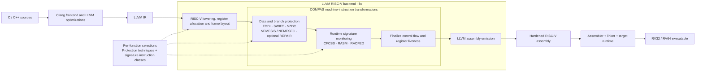

# compas-ft-riscv

> **TL;DR:** COMPAS adds software fault tolerance to RISC-V programs through LLVM's backend. Select functions, combine data and branch protection with runtime signature monitoring, and generate hardened RV32/RV64 assembly. Use it to explore compiler-assisted resilience against soft errors and instruction-skip faults without modifying the processor.


[](LICENSE)
[](https://github.com/tum-ei-eda/compas-ft-riscv/actions/workflows/ci.yml)
[](https://github.com/tum-ei-eda/compas-ft-riscv/actions/workflows/container.yml)
[](https://github.com/tum-ei-eda/compas-ft-riscv/actions/workflows/doc.yml)

**[Project website](https://tum-ei-eda.github.io/compas-ft-riscv/)** · **[User manual](https://tum-ei-eda.github.io/compas-ft-riscv/manual/)** · [Build and contribution guide](docs/CONTRIBUTING.md) · [Tests](tests/README.adoc)

COMPAS stands for *Compiler-assisted Software-implemented Hardware Fault Tolerance*. Its passes insert redundant computations and checks at the machine-instruction level. Per-function selections let you protect critical code and study the cost and coverage of individual techniques or layered combinations.

## Compiler flow

COMPAS hooks into LLVM's RISC-V backend. LLVM lowers the input IR with COMPAS-aware register and frame handling; the backend then applies the selected data/branch transformations followed by signature monitoring before emitting hardened assembly. The assembler and linker produce the target program using its usual startup code and runtime.



| Protection | Techniques |
| --- | --- |
| Data and branch redundancy | [EDDI](https://ieeexplore.ieee.org/document/994913), [SWIFT](https://ieeexplore.ieee.org/document/1402092), [NZDC](https://ieeexplore.ieee.org/document/7544291), NZDC + [NEMESIS](https://ieeexplore.ieee.org/document/8203792), NZDC + [NEMESEC](https://doi.org/10.1145/3566097.3567925) |
| Runtime signature monitoring | [CFCSS](https://ieeexplore.ieee.org/document/994926), [RASM](https://ieeexplore.ieee.org/document/8067656), [RACFED](https://doi.org/10.1007/978-3-319-99130-6_15) |
| Recovery extension | [REPAIR](https://doi.org/10.1145/3477001) on the NZDC family |

Signature monitoring can cover original instructions (`orig`), DMR-generated instructions (`dmr`), protection checks (`balance`), or combinations. The default is `all`; `orig+dmr` selects the CompaSeC composition. See [RSM instruction selection](docs/rsm-layering.adoc) for how each signature scheme uses these classes.

## Setup

COMPAS builds inside a patched LLVM source tree. The current CI uses **LLVM 16.0.6**; version-specific integration patches also cover 13.0.1, 14.0.6 and 15.0.7. Install a host C++ compiler, CMake, Git, Python 3 and LLVM's build dependencies, then run from this cloned repository:

```sh
COMPAS_SRC="$PWD"
LLVM_SRC="$COMPAS_SRC/build/llvm-project"
export COMPAS_LLVM_ROOT="$COMPAS_SRC/build/llvm-build"

mkdir -p build
git clone --depth 1 --branch llvmorg-16.0.6 \
  https://github.com/llvm/llvm-project.git "$LLVM_SRC"
git -C "$LLVM_SRC" apply "$COMPAS_SRC/patches/llvm16.0.6_src.patch"
ln -s "$COMPAS_SRC" "$LLVM_SRC/llvm/lib/Target/RISCV/compas-ft-riscv"
cmake -S "$LLVM_SRC/llvm" -B "$COMPAS_LLVM_ROOT" \
  -DCMAKE_BUILD_TYPE=Release -DCMAKE_CXX_STANDARD=17 \
  -DLLVM_ENABLE_PROJECTS=clang -DLLVM_TARGETS_TO_BUILD=RISCV \
  -DLLVM_ENABLE_ASSERTIONS=ON
cmake --build "$COMPAS_LLVM_ROOT" --parallel 2 --target clang llc
```

Apply the patch once per LLVM source tree and keep Clang and `llc` from the same build. The [build guide](docs/CONTRIBUTING.md#development-and-validation) includes dependencies, compiler caching and development checks. Prebuilt compiler containers are described in the [Docker guide](docker/README.adoc).

## Usage

This example hardens one function with NZDC + NEMESEC and RASM, monitoring original and duplicated instructions. It produces assembly without requiring target C library headers:

```sh
mkdir -p build/quickstart
cat > build/quickstart/kernel.c <<'EOF'
unsigned kernel(unsigned x) {
    return (x * 17u) ^ (x >> 3);
}
EOF

"$COMPAS_LLVM_ROOT/bin/clang" \
  --target=riscv32 -march=rv32im -mabi=ilp32 \
  -O2 -ffreestanding -S -emit-llvm \
  build/quickstart/kernel.c -o build/quickstart/kernel.ll

"$COMPAS_LLVM_ROOT/bin/llc" \
  -mtriple=riscv32 -mattr=+m -O2 \
  -NZDC+NEMESEC=kernel -RASM=kernel:orig+dmr \
  build/quickstart/kernel.ll -o build/quickstart/kernel.hardened.s
```

Use comma-separated compiler symbol names to select multiple functions. For example, `-EDDI=foo,bar -CFCSS=foo,bar` layers EDDI and CFCSS on those functions; omitting a technique leaves it disabled. Signature suffixes belong to the existing `-RASM`, `-CFCSS` or `-RACFED` selection.

To assemble the result, point `RISCV_GCC` at your RISC-V GNU cross-compiler:

```sh
RISCV_GCC=/path/to/riscv-toolchain/bin/riscv-none-elf-gcc
"$RISCV_GCC" -march=rv32im -mabi=ilp32 -c \
  build/quickstart/kernel.hardened.s -o build/quickstart/kernel.hardened.o
```

Link this object into an application with matching ISA/ABI and the required startup code and runtime. See the [user manual](https://tum-ei-eda.github.io/compas-ft-riscv/manual/) for compiler options and the [CRC example](docs/CONTRIBUTING.md#functional-validation) for a complete CMake application flow. The [test guide](tests/README.adoc) explains functional equivalence checks and execution with QEMU or Spike; known limitations are tracked in [tests/TODO.md](tests/TODO.md).

## Publications

Please cite the relevant work when using COMPAS, CompaSeC or REPAIR:

- [COMPAS: Compiler-assisted Software-implemented Hardware Fault Tolerance for RISC-V](https://doi.org/10.1109/MECO55406.2022.9797144), MECO 2022.
- [CompaSeC: A Compiler-Assisted Security Countermeasure to Address Instruction Skip Fault Attacks on RISC-V](https://doi.org/10.1145/3566097.3567925), ASP-DAC 2023.
- [REPAIR: Control Flow Protection Based on Register Pairing Updates for SW-Implemented HW Fault Tolerance](https://doi.org/10.1145/3477001), ACM TECS, 2021.

<details>
<summary>BibTeX</summary>

```bibtex
@inproceedings{compas2022,
  author={Sharif, Uzair and Mueller-Gritschneder, Daniel and Schlichtmann, Ulf},
  booktitle={2022 11th Mediterranean Conference on Embedded Computing (MECO)},
  title={COMPAS: Compiler-assisted Software-implemented Hardware Fault Tolerance for RISC-V},
  year={2022},
  volume={},
  number={},
  pages={1-4},
  doi={10.1109/MECO55406.2022.9797144}}

@inproceedings{compasec2023,
  author = {Geier, Johannes and Auer, Lukas and Mueller-Gritschneder, Daniel and Sharif, Uzair and Schlichtmann, Ulf},
  title = {CompaSeC: A Compiler-Assisted Security Countermeasure to Address Instruction Skip Fault Attacks on RISC-V},
  year = {2023},
  isbn = {9781450397834},
  publisher = {Association for Computing Machinery},
  address = {New York, NY, USA},
  url = {https://doi.org/10.1145/3566097.3567925},
  doi = {10.1145/3566097.3567925},
  booktitle = {Proceedings of the 28th Asia and South Pacific Design Automation Conference},
  pages = {676–682},
  numpages = {7},
  keywords = {RISC-V, compiler, fault injection attack, redundancy},
  location = {Tokyo, Japan},
  series = {ASPDAC '23}
}

@article{repair2021,
  author = {Sharif, Uzair and Mueller-Gritschneder, Daniel and Schlichtmann, Ulf},
  title = {REPAIR: Control Flow Protection Based on Register Pairing Updates for SW-Implemented HW Fault Tolerance},
  journal = {ACM Transactions on Embedded Computing Systems},
  year = {2021},
  volume = {20},
  number = {5s},
  articleno = {70},
  numpages = {22},
  url = {https://doi.org/10.1145/3477001},
  doi = {10.1145/3477001}
}
```

</details>

## Contributing and license

See [CONTRIBUTING.md](docs/CONTRIBUTING.md) for development, validation and commit conventions. COMPAS is licensed under [Apache-2.0](LICENSE).
